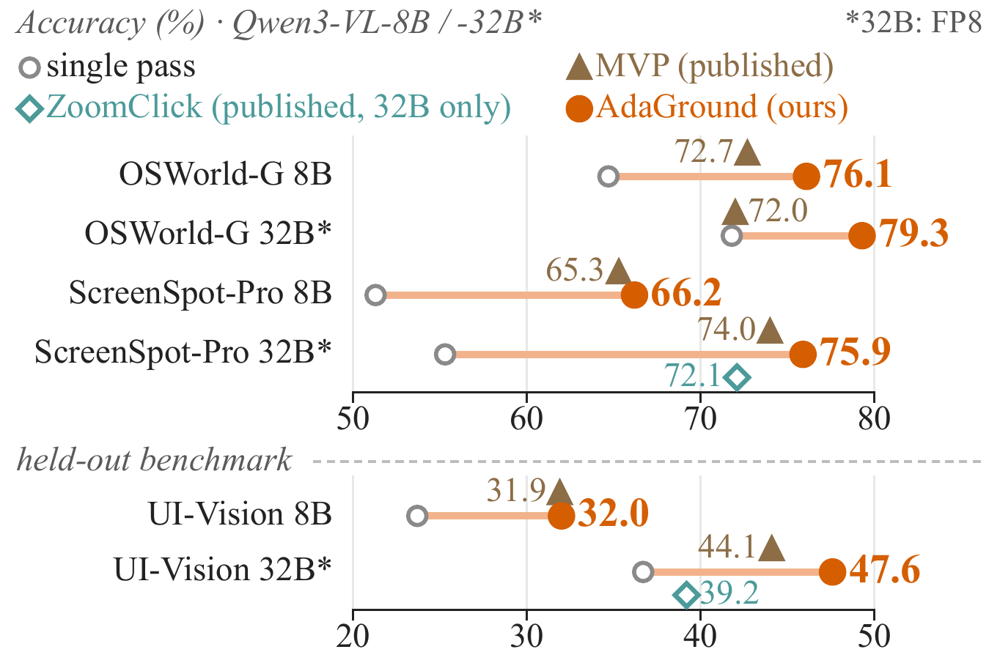
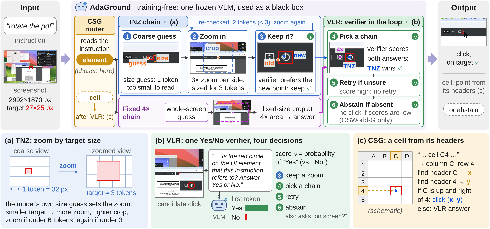
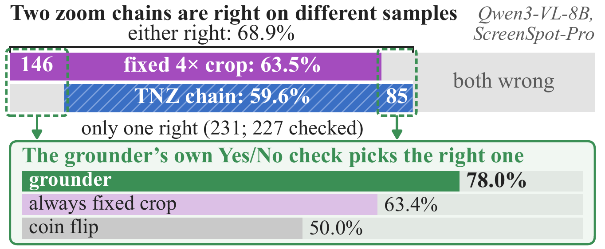

<div align="center">

<h1>AdaGround: Token-Normalized Adaptive Zooming with Verifier-in-the-Loop Refinement for GUI Grounding</h1>

<p>
  Bingchao Wang<sup>1,2</sup> ·
  Yongcheng Jing<sup>2</sup> ·
  Chengyu Wang<sup>3</sup> ·
  Jun Huang<sup>3</sup> ·
  Jie Yang<sup>1,&dagger;</sup> ·
  Wei Liu<sup>1,&dagger;</sup> ·
  Dacheng Tao<sup>2,&dagger;</sup>
</p>

<p>
  <sup>1</sup>Shanghai Jiao Tong University &nbsp;&nbsp;
  <sup>2</sup>Nanyang Technological University &nbsp;&nbsp;
  <sup>3</sup>Alibaba Cloud Computing<br>
  <sub><sup>&dagger;</sup>Corresponding authors</sub>
</p>

<p>
  <a href="https://arxiv.org/abs/2610.36874"></a>
  <a href="https://arxiv.org/pdf/2610.36874"></a>
  <a href="#-main-results"></a>
  <a href="LICENSE"></a>
</p>

<p><strong>A training-free, black-box framework in which the grounder sizes its own zoom and verifies its own answers.</strong></p>


<p><em>Accuracy of AdaGround, the single pass and the published results of MVP and ZoomClick, each measured from its own single pass.<br>UI-Vision is held out; 32B uses FP8 weights.</em></p>

</div>

## 🔥 News

- **2026-10** · Code released.
- **2026-10** · Paper available on [arXiv](https://arxiv.org/abs/2610.36874).

## ✨ Highlights

> **Key idea.** Differently zoomed views fail on different samples. Instead of committing to one zoom, AdaGround sizes each zoom to the target and lets the grounder itself, shown a marked click, decide which answer to trust.

- **Zoom sized to the target.** Token-Normalized Adaptive Zooming (TNZ) sets the magnification, the field of view and the number of zoom stages of every sample from the model's own estimate of the target size, so that the target spans a fixed number of visual tokens.
- **One verifier, four decisions.** A single marked-click Yes/No check keeps or rejects each zoom, arbitrates between two zoom chains, triggers re-grounding with the rejected click crossed out, and, with an existence query, decides when to abstain.
- **Training-free and black-box.** Images and text in, text and first-token probabilities out. One configuration serves both backbones and all four benchmarks.
- **Strong gains.** +14.9 and +20.6 points over the single pass on ScreenSpot-Pro (Qwen3-VL-8B / 32B), 76.1 and 79.3 on OSWorld-G, and gains that carry over to held-out UI-Vision.

## 🧭 Method

<div align="center">

</div>

| Component | What it does |
|---|---|
| **TNZ** (Token-Normalized Adaptive Zooming) | From the model's box on the coarse view, solves the magnification, the crop side and the zoom depth so that the target spans τ = 3 visual tokens while the crop still covers the coarse localization error. |
| **VLR** (Verifier-in-the-Loop Refinement) | One marked-click Yes/No verifier drives *verification-gated acceptance* of every zoom, *chain arbitration* between the TNZ chain and a fixed 4× crop chain, *negative-feedback re-grounding*, and *existence-gated abstention*. |
| **CSG** (Compositional Structure Grounding) | Rewrites an instruction that names a spreadsheet cell into a program and composes the cell from its separately grounded column and row headers. |

<details>
<summary><b>Why two chains?</b> The fixed crop and TNZ are right on different samples.</summary>
<br>
<div align="center">

</div>

On ScreenSpot-Pro with Qwen3-VL-8B, the fixed 4× crop and the TNZ chain are right on 63.5% and 59.6% of the samples, but at least one of them is right on 68.9%. The grounder's own Yes/No check picks the right answer when the two clicks differ.
</details>

## 📊 Main Results

Accuracy (%) on OSWorld-G (refined instructions, 564 samples, including 54 absent-target instructions that count only when the system abstains), ScreenSpot-Pro (1,581) and UI-Vision element grounding (5,479, held out). Subscripts give the gain over each method's own single pass.

| Backbone | Method | OSWorld-G | ScreenSpot-Pro | UI-Vision (held-out) |
|---|---|:---:|:---:|:---:|
| **Qwen3-VL-8B** | Single pass | 64.7 | 51.3 | 23.7 |
| | MVP <sup>†</sup> | 72.7 <sub>+3.9</sub> | 65.3 <sub>+10.3</sub> | 31.9 <sub>+4.7</sub> |
| | **AdaGround** | **76.1** <sub>+11.3</sub> | **66.2** <sub>+14.9</sub> | **32.0** <sub>+8.3</sub> |
| **Qwen3-VL-32B** <sup>*</sup> | Single pass | 71.8 | 55.3 | 36.7 |
| | MVP <sup>†</sup> | 72.0 <sub>+0.3</sub> | 74.0 <sub>+18.7</sub> | 44.1 <sub>+7.7</sub> |
| | ZoomClick <sup>†</sup> | – | 72.1 <sub>+18.1</sub> | 39.2 <sub>+2.6</sub> |
| | **AdaGround** | **79.3** <sub>+7.4</sub> | **75.9** <sub>+20.6</sub> | **47.6** <sub>+10.9</sub> |

<sub><sup>†</sup> Published results, each measured from its own single pass. <sup>*</sup> FP8 weights.</sub>

<details>
<summary><b>Where the gains come from</b> (components added one at a time)</summary>
<br>

| | OSWorld-G 8B | OSWorld-G 32B | ScreenSpot-Pro 8B | ScreenSpot-Pro 32B | ScreenSpot-v2 8B | ScreenSpot-v2 32B |
|---|:---:|:---:|:---:|:---:|:---:|:---:|
| Single pass | 64.7 | 71.8 | 51.3 | 55.3 | 92.1 | 94.7 |
| Fixed 4× crop | 70.7 | 77.1 | 63.5 | 73.9 | 91.9 | 95.4 |
| c<sub>TNZ</sub> | 72.7 | 76.6 | 59.6 | 72.4 | 92.5 | 95.4 |
| + arbitration | 73.6 | 76.8 | 65.6 | 75.6 | 92.5 | 96.0 |
| + re-grounding | 73.2 | 77.0 | 66.2 | 76.0 | 91.9 | 95.4 |
| + CSG | 73.6 | 77.8 | 66.2 | 75.9 | 91.9 | 95.4 |
| + abstention (**AdaGround**) | **76.1** | **79.3** | **66.2** | **75.9** | **91.9** | **95.4** |
| *Oracle of the two chains* | *76.1* | *79.8* | *68.9* | *78.8* | *94.0* | *96.6* |

Abstention is enabled only on OSWorld-G, the one benchmark whose protocol contains instructions without a target. On ScreenSpot-v2 the targets are large and the single pass already resolves most of them.
</details>

## ⚙️ Installation

```bash
git clone https://github.com/bcwang-sjtu/AdaGround.git
cd AdaGround
conda create -n adaground python=3.11 -y
conda activate adaground
pip install -r requirements.txt
```

The paper results were obtained with Python 3.11, PyTorch 2.9.0 (CUDA 12.8), vLLM 0.11.2, Transformers 4.57.1 and qwen-vl-utils 0.0.14 on NVIDIA H20 GPUs. Both backbones run on a single GPU (Qwen3-VL-32B with FP8 weights).

Download a backbone (or pass the Hugging Face id directly):

```bash
hf download Qwen/Qwen3-VL-8B-Instruct --local-dir models/Qwen3-VL-8B-Instruct
hf download Qwen/Qwen3-VL-32B-Instruct-FP8 --local-dir models/Qwen3-VL-32B-Instruct-FP8
```

## 📂 Data Preparation

```bash
# ScreenSpot-Pro
hf download likaixin/ScreenSpot-Pro --repo-type dataset --local-dir data/ScreenSpot-Pro

# ScreenSpot-v2
hf download OS-Copilot/ScreenSpot-v2 --repo-type dataset --local-dir data/ScreenSpot-v2
unzip -q data/ScreenSpot-v2/screenspotv2_image.zip -d data/ScreenSpot-v2

# UI-Vision (element grounding)
hf download ServiceNow/ui-vision --repo-type dataset --local-dir data/ui-vision

# OSWorld-G (refined instructions)
git clone https://github.com/xlang-ai/OSWorld-G.git data/OSWorld-G-repo
ln -s OSWorld-G-repo/benchmark data/OSWorld-G
```

<details>
<summary>Expected layout</summary>

```
data/
├── ScreenSpot-Pro/
│   ├── annotations/*.json
│   └── images/<application>/*.png
├── ScreenSpot-v2/
│   ├── screenspot_{desktop,mobile,web}_v2.json
│   └── screenspotv2_image/*.png
├── ui-vision/
│   ├── annotations/element_grounding/element_grounding_{basic,functional,spatial}.json
│   └── images/element_grounding/*.png
└── OSWorld-G/
    ├── OSWorld-G_refined.json
    ├── classification_result.json
    └── images/*.png
```
</details>

## 🚀 Quick Start

One command runs all stages on a benchmark, then composes and scores the final answers:

```bash
# bash scripts/run_adaground.sh BENCHMARK MODEL_SIZE MODEL_PATH DATA_DIR OUTPUT_DIR [IDS_FILE]
bash scripts/run_adaground.sh sspro 8b models/Qwen3-VL-8B-Instruct data/ScreenSpot-Pro outputs/qwen3vl8b/sspro
```

`BENCHMARK` is one of `sspro`, `osworldg`, `ssv2`, `uivision`, and `MODEL_SIZE` (`8b` or `32b`) selects the vLLM engine settings of the paper. Finished stages are skipped, so an interrupted run resumes where it stopped. To try a subset first, pass a JSON list of sample ids as `IDS_FILE`.

The script ends with a report like this one (Qwen3-VL-8B on OSWorld-G):

```
AdaGround on osworldg: 564 samples from 1 run directory (tau=3, theta_r=0.99, abstention: joint rule, theta_e=0.03)
                                  acc   correct/n  tokens/sample   present targets
  single pass (c4x pass 1)       64.7     365/564         1693.3     71.6 (365/510)
  fixed 4x crop (c4x final)      70.7     399/564         5343.3     78.2 (399/510)
  component ladder
  c_TNZ                          72.7     410/564        10423.4     80.4 (410/510)
  +arbitration                   73.6     415/564        16184.3     81.4 (415/510)
  +re-grounding                  73.2     413/564        17737.4     81.0 (413/510)
  +CSG                           73.6     415/564        17914.7     81.4 (415/510)
  +abstention (= AdaGround)      76.1     429/564        19543.4     81.2 (414/510)
```

## 🔁 Reproducing the Paper

```bash
declare -A DATA=([osworldg]=data/OSWorld-G [sspro]=data/ScreenSpot-Pro [ssv2]=data/ScreenSpot-v2 [uivision]=data/ui-vision)
for B in osworldg sspro ssv2 uivision; do
  bash scripts/run_adaground.sh $B 8b  models/Qwen3-VL-8B-Instruct      ${DATA[$B]} outputs/qwen3vl8b/$B
  bash scripts/run_adaground.sh $B 32b models/Qwen3-VL-32B-Instruct-FP8 ${DATA[$B]} outputs/qwen3vl32b/$B
done
```

Each run executes the six model stages below and writes one JSON file per stage. All constants are fixed to the paper's configuration (τ = 3, θ<sub>r</sub> = 0.99, θ<sub>e</sub> = 0.03, 1288×728 fixed-crop window); decoding is greedy.

| Stage | Mode | Output | What it computes |
|---|---|---|---|
| 1 | `zoom` | `c4x.json` | Fixed 4× crop chain c<sub>4×</sub>; its first pass is the single-pass baseline. |
| 2 | `exist` | `exist.json` | Existence query e(S, I) (OSWorld-G only). |
| 3 | `program` | `csg_cell.json` | CSG: instruction program and header grounding for spreadsheet cells. |
| 4 | `tsn` | `tnz_t3.json` | TNZ chain c<sub>TNZ</sub> with verification-gated acceptance. |
| 5 | `choose2` | `arb_t3.json` | Verifier arbitration between c<sub>TNZ</sub> and c<sub>4×</sub>. |
| 6 | `retry` | `rg_t3_tau0.99.json` | Negative-feedback re-grounding of the arbitrated answer. |

Composition and scoring run offline and can be repeated on finished runs; several output directories (for example, shards of one benchmark) are merged per sample:

```bash
python -m adaground.compose --run_dir outputs/qwen3vl8b/osworldg --benchmark osworldg \
    --osworldg_labels data/OSWorld-G/OSWorld-G_refined.json --out outputs/qwen3vl8b/osworldg/predictions.json
```

Keep `--chunk`, `--max_num_seqs` and `--gpu_mem_util` at the values set by the script: vLLM batching can change the numerics slightly.

## 🗂️ Repository Structure

```
AdaGround/
├── adaground/
│   ├── infer.py          # the six model stages (vLLM)
│   ├── compose.py        # CSG header rule, abstention, component ladder, report
│   └── scoring.py        # point-in-box and official OSWorld-G scoring
├── scripts/
│   └── run_adaground.sh  # end-to-end run on one benchmark
├── assets/               # figures used in this README
├── requirements.txt
└── LICENSE
```

## 📝 Citation

If you find AdaGround useful, please cite:

```bibtex
@article{wang2026adaground,
  title   = {AdaGround: Token-Normalized Adaptive Zooming with Verifier-in-the-Loop Refinement for GUI Grounding},
  author  = {Wang, Bingchao and Jing, Yongcheng and Wang, Chengyu and Huang, Jun and Yang, Jie and Liu, Wei and Tao, Dacheng},
  journal = {arXiv preprint arXiv:2610.36874},
  year    = {2026}
}
```

## 🙏 Acknowledgement

AdaGround runs on [Qwen3-VL](https://github.com/QwenLM/Qwen3-VL) with [vLLM](https://github.com/vllm-project/vllm). We thank the authors of [ScreenSpot-Pro](https://github.com/likaixin2000/ScreenSpot-Pro-GUI-Grounding), [OSWorld-G](https://github.com/xlang-ai/OSWorld-G), [ScreenSpot-v2](https://huggingface.co/datasets/OS-Copilot/ScreenSpot-v2) and [UI-Vision](https://huggingface.co/datasets/ServiceNow/ui-vision) for releasing their benchmarks.

## 📄 License

This project is released under the [MIT License](LICENSE).
